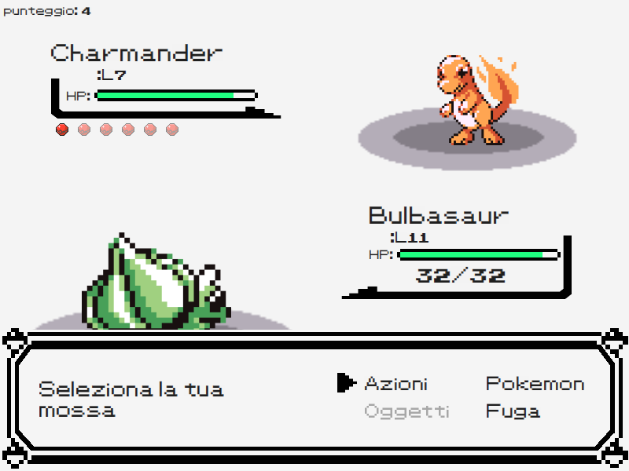
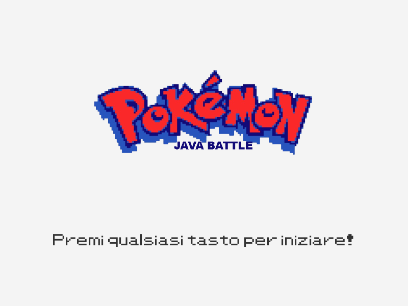
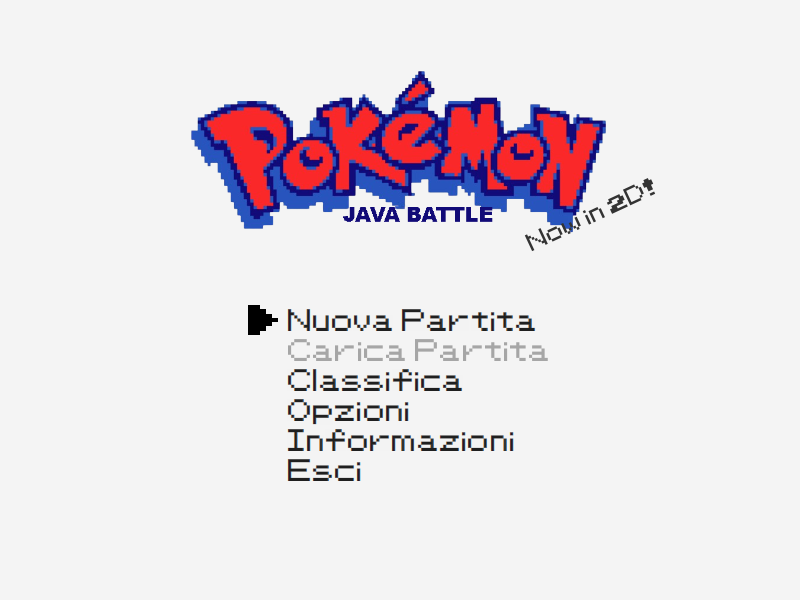
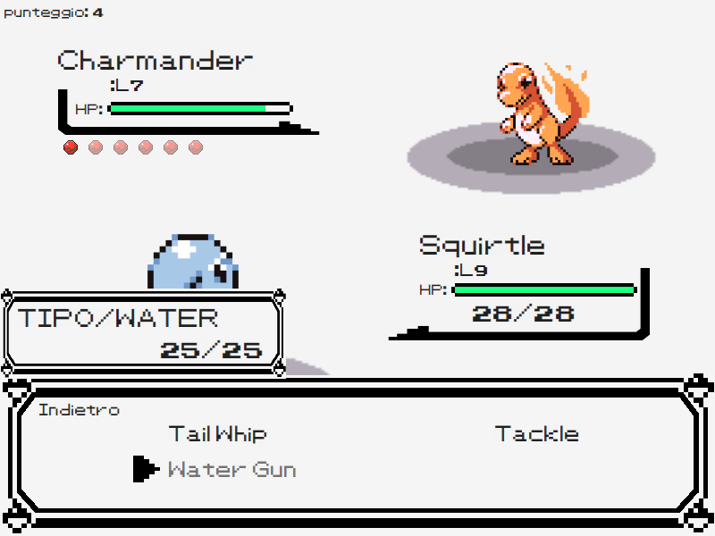
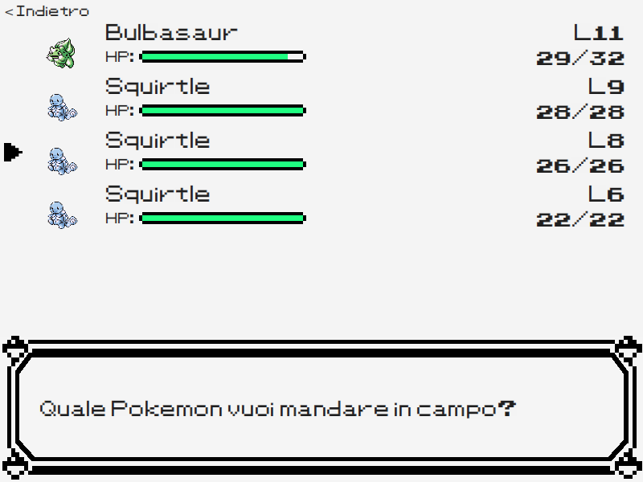
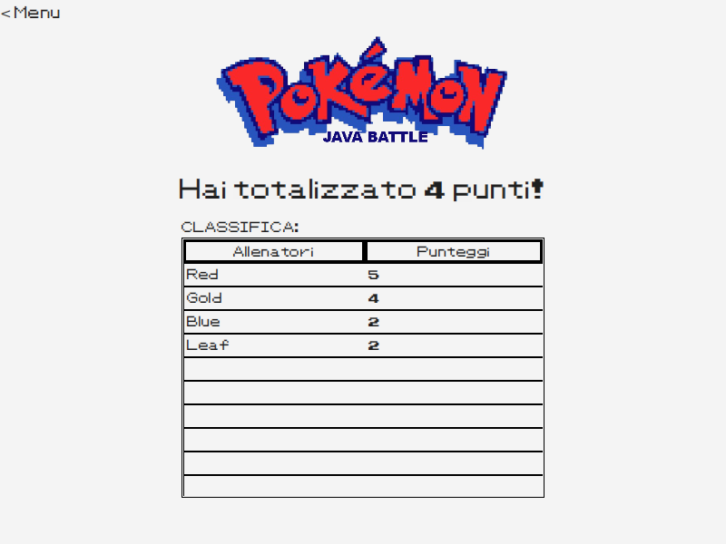
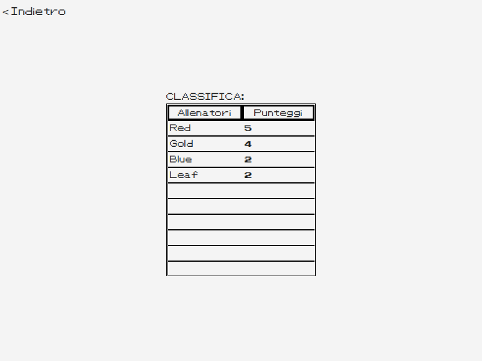
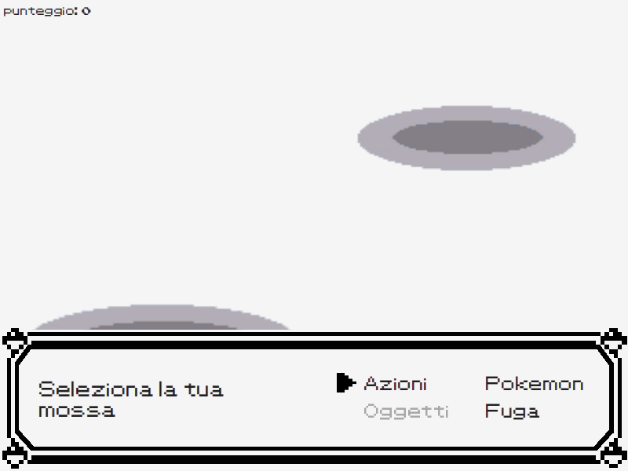

# JPokeBattle

<p align="center">
  
</p>

JPokeBattle is a turn-based battle game in the style of the first-generation Pokémon games, written in Java with JavaFX.
You get a random starter and battle one randomly generated trainer after another until your whole team faints.
Defeated Pokémon can join your team, your Pokémon level up, learn moves and evolve, and the CPU trainers get stronger and smarter as your score grows.
I wrote it as a first-year Computer Science student at Sapienza University of Rome, as the final project for the Programming Methodologies course.
The code follows an MVC structure and uses several classic design patterns, so it can be useful to students taking the same course.

> The in-game text is in Italian. A short glossary is in [How to play](#how-to-play).

## Features

- **Nine Pokémon in three evolution lines:** Bulbasaur, Charmander and Squirtle, with their evolutions.
- **Gen 1 battle mechanics,** based on Bulbapedia: damage formula, type effectiveness, same-type attack bonus, critical hits, misses and random damage rolls.
- **Growth system:** experience and level-up groups, IVs, EVs (effort values), stat recalculation, evolution and learning new moves.
- **Endless run:** each defeated trainer is worth one point. Your team keeps its HP and status from one battle to the next, so the run ends when every Pokémon you own has fainted.
- **Catching:** after a win there is a 50% chance to catch one of the defeated trainer's Pokémon, for a team of up to six. With a full team, you choose which Pokémon to replace.
- **CPU trainers with two difficulty levels:** the Easy AI attacks on about one turn in five and uses status moves otherwise. From 10 points on, the Medium AI attacks on one turn in three and switches to a Pokémon with a type advantage when its current one is weak. Opponent levels and team sizes follow your team's level and your score.
- **Battle commentator:** every action is described in plain language, for example "Bulbasaur used Vine Whip, it dealt a lot of damage!". At the moment the commentary is printed to the console, not shown on screen.
- **Persistent leaderboard:** the ten best scores are saved to `leaderboard.txt` and shown at the end of each run and from the main menu.
- **Custom JavaFX components:** grid menus with an arrow cursor, animated health bars, Pokémon info cards, a team list and an animated battle intro, all with a Game Boy-style pixel font.
- **Sound:** title, battle and victory music, plus menu sound effects.

## Screenshots

| Title screen | Main menu |
| --- | --- |
|  |  |
| **Choosing a move** | **Your team** |
|  |  |
| **End of a run** | **Leaderboard** |
|  |  |

A short battle clip (battle intro, move selection, a hit draining the opponent's HP): [battle.gif](docs/media/battle.gif) or [battle.webm](docs/media/battle.webm).

<p align="center">
  
</p>

## Quick start

You need a **JDK 17 or newer** (for example [Eclipse Temurin](https://adoptium.net/)). You do not need to install Gradle or JavaFX: the Gradle wrapper downloads both.

```bash
git clone https://github.com/uniquadev/jpokebattle.git
cd jpokebattle
./gradlew run        # on Windows: gradlew.bat run
```

Other useful tasks:

| Command | Result |
| --- | --- |
| `./gradlew fatJar` | Builds `build/libs/jpokebattle-1.0.0-all.jar`, a single runnable jar: `java -jar build/libs/jpokebattle-1.0.0-all.jar` |
| `./gradlew installDist` | Builds a folder with start scripts in `build/install/jpokebattle/bin/` |
| `./gradlew distZip` | Builds the same distribution as a zip in `build/distributions/` |

The fat jar contains JavaFX for one operating system only, the one you build on. To build for another one, add `-PjavafxPlatform=win`, `linux`, `mac` or `mac-aarch64`.

Run the fat jar with `java -jar jpokebattle-1.0.0-all.jar` (Java 17 or newer).

**No JDK installed?** You can build inside Docker:

```bash
docker run --rm -v "$PWD":/work -w /work eclipse-temurin:21-jdk ./gradlew fatJar
```

## How to play

The game is played with the mouse. Move the pointer over a menu entry to select it, then click to confirm.

1. On the title screen, press any key or click.
2. In the main menu, choose **Nuova Partita** (New Game).
3. Type your trainer name and press Enter, or click the arrow. If you leave it empty, a random name is used.
4. You start with a random starter. In battle:
   - **Azioni** (Fight): pick a move. While you hover a move, the box on the left shows its type and remaining uses.
   - **Pokemon**: switch the active Pokémon. A switch during battle uses your turn.
   - **Fuga** (Run): ends the run. If you scored at least one point, the results screen and the leaderboard appear.
5. Win to earn points, catch Pokémon and level up. The run ends when all your Pokémon have fainted.

Some menu entries are placeholders that were not part of the project: **Carica Partita** (Load Game), **Opzioni** (Options) and **Oggetti** (Bag).

| Italian | English |
| --- | --- |
| Nuova Partita | New Game |
| Classifica | Leaderboard |
| Informazioni | About |
| Esci | Quit |
| Indietro | Back |
| punteggio | score |

## Architecture

The project follows the **Model-View-Controller** pattern on top of JavaFX. Every screen is an FXML view with a dedicated controller, and the game logic does not depend on the UI.

```
src/jpokebattle/
├── JPokeBattle.java   JavaFX Application: owns the stage and switches views
├── Launcher.java      plain main() entry point, used by the jar and the distribution
├── model/             Pokemon, PokeMove, PokeStats, Trainer, BattleAction, MoveResult, PlayerScore
├── view/              FXML layouts: start, menu, setup, battle, finish, leader, info
├── controller/        one controller per view
├── gui/               custom JavaFX components: GridMenu, HealthBar, PokemonView, PokeInfoCard, PokeTeamList, ...
├── battle/            BattleHandler and TurnHandler (turn order and resolution), BattleCommentor
├── cpu/               CPUHandler, EasyCPUHandler, MediumCPUHandler
├── pokemon/           PokemonInfo plus one class per species
├── move/              BaseMove plus one class per move
├── service/           GameState, PokeService, MoveService, SoundService, Leaderboard
├── utils/             PokeBuilder, TrainerBuilder, GenerationSettings, PokeRandomizer, LeaderboardFile, SplashText
├── enums/, interfaces/
└── resources/         sprites, sounds, pixel font and styles.css
```

Design patterns and principles used:

- **Singleton:** global services (`GameState`, `PokeService`, `MoveService`, `SoundService`, `Leaderboard`).
- **Builder:** `PokeBuilder` creates valid Pokémon with moves, type and individual stats. `TrainerBuilder` uses it to generate the starter and every random opponent, so no half-built objects exist.
- **Template Method:** `PokemonInfo`, `BaseMove`, `TurnHandler` and the CPU handlers hold the shared logic. Each concrete species, move or AI fills in only what is specific to it.
- **Callback:** the UI components (`GridMenu`, `PokeTeamList`, `HealthBar`) report clicks, selections and finished animations to their controllers through callbacks.
- **SOLID:** single-responsibility classes, extension without modification (adding a species, a move or a CPU level means adding a subclass), and controllers that depend on abstractions.

Original course documents (both in Italian):

- [diagramma.pdf](diagramma.pdf): UML class diagram. The editable source is [diagramma.drawio](diagramma.drawio).
- [relazione.pdf](relazione.pdf): project report with the implemented features, design decisions and lessons learned.

The `data/` folder contains the Aseprite source files of the custom sprites (arrows, health bar, battle terrain).

## For students

I built this game in my first year of the Computer Science bachelor at Sapienza University of Rome, for the course *Metodologie di Programmazione* (Programming Methodologies), academic year 2023/24.
The course asked for a Pokémon-style battle game in Java to practise object-oriented design.
Feel free to read the code and learn from it. If you are taking the course, follow your course's rules on collaboration and plagiarism: submitting this code, or parts of it, as your own work is not allowed.

The code is a first-year project and has rough edges. For example, the commentator only writes to the console, the HP number of your Pokémon is not updated during a battle, and some menu entries do nothing. The report lists the lessons I learned, such as commenting code from the start and preferring small, specific interfaces (the Interface Segregation Principle).

## Disclaimer

This is an unofficial, non-commercial fan project made for educational purposes.
Pokémon, the Pokémon names, sprites, sounds, music and logo are © Nintendo, Game Freak and Creatures / The Pokémon Company.
This project is not affiliated with, endorsed by or sponsored by any of them.
All rights to these assets remain with their owners.

## License

The source code is released under the [MIT License](LICENSE).
The MIT License covers only the original source code. It does not cover the Pokémon assets listed in the disclaimer.

## Support ☕

If this game helped you with your own Programming Methodologies project, or you just had fun playing it, you can buy me a coffee. It keeps more university projects coming to GitHub.

<a href="https://buymeacoffee.com/uniqua"></a>
